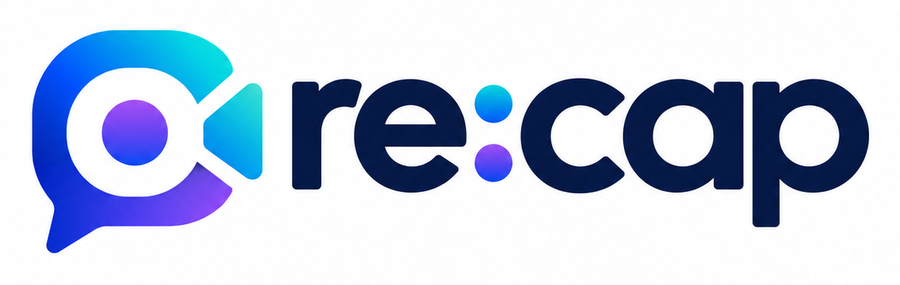
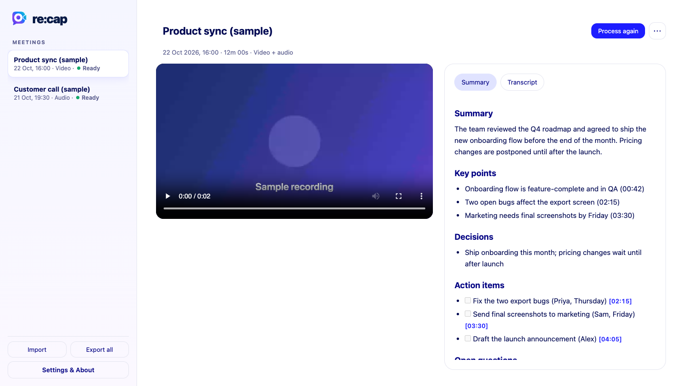
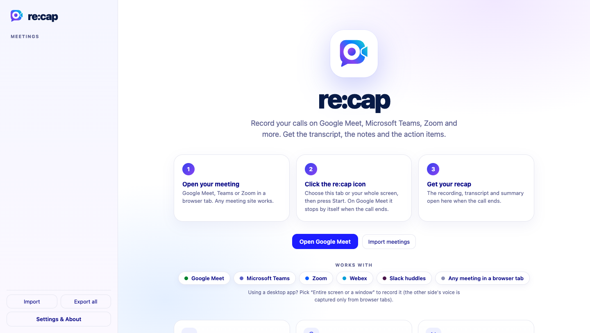

<p align="center">
  
</p>

<h3 align="center">Record your calls. Get the transcript, the notes and the action items.</h3>

<p align="center">
  A Chrome extension that records meetings on <b>Google Meet, Microsoft Teams, Zoom</b> and any other meeting site you open in a browser tab,
  then turns them into a searchable transcript, an AI summary and a list of action items.<br>
  <b>Free for life · No account · No servers · Your recordings stay on your machine.</b>
</p>

<p align="center">
  
</p>
<p align="center"><sub>Sample data. A recorded meeting with the video, an AI summary and timestamped action items.</sub></p>

---

## Contents
- [Features](#features)
- [Install](#install)
- [Set up the AI (free API key)](#set-up-the-ai-free-api-key)
- [Permissions you need to allow](#permissions-you-need-to-allow)
- [How to use it](#how-to-use-it)
- [Using other AI providers (OpenAI, Claude, Gemini, your own)](#using-other-ai-providers)
- [Your data: storage, export and import](#your-data-storage-export-and-import)
- [Supported meeting apps](#supported-meeting-apps)
- [Troubleshooting](#troubleshooting)
- [Privacy](#privacy)
- [Project structure](#project-structure)
- [Developer and sponsor](#developer-and-sponsor)

## Features

| | |
|---|---|
| **Records video and audio** | Record the meeting tab, or your whole screen / a single window, together with your microphone. |
| **Transcript** | Every word with timestamps. Click a timestamp and the video jumps to that moment. |
| **AI notes** | A summary, key points, decisions, action items and open questions for every call. |
| **Stops by itself** | On Google Meet, recording stops when the call ends and the finished meeting opens in a new tab. |
| **Tells everyone** | On Google Meet it posts a recording notice in the call chat (you can edit the text or turn it off). |
| **Free for life** | No account, no subscription, no ads. You bring your own API key, and a free Groq key is enough. |
| **Stays on your machine** | Recordings are stored in your browser. re:cap has no servers. |
| **Import and export** | Back up every meeting as plain files (video, transcript, notes) and import them again any time. |
| **Download anything** | Save the recording (`.webm`), or the notes as Markdown, from the **⋯** menu of a meeting. |
| **Any language** | Pick your meeting language (Hindi, English, German and many more) for a more accurate transcript. |

<p align="center">
  
</p>

## Install

re:cap is a Manifest V3 extension and needs **Chrome 116 or newer** (other Chromium browsers such as Edge or Brave may work too, but only Chrome has been tested).

**From the Chrome Web Store:** search for **re:cap** and click **Add to Chrome** *(once published)*.

**From source (developer mode):**

1. Download or clone this folder.
2. Open `chrome://extensions` in Chrome.
3. Turn on **Developer mode** (top right).
4. Click **Load unpacked** and choose this folder (the one containing `manifest.json`).
5. Click the puzzle-piece icon in the toolbar and **pin** re:cap.

> After you change any file or update the extension, click the reload icon on its card in `chrome://extensions`, and **refresh your Meet tab**.

> On a work-managed Chrome, an administrator may block extensions you load yourself. In that case ask your IT admin to allow it, or use a personal Chrome profile.

## Set up the AI (free API key)

re:cap needs an AI provider for two jobs: **transcription** (audio → text) and the **summary** (text → notes).
It sends audio and text only to the provider **you** choose, using **your own** key. The easiest option is **Groq**, which is **free and needs no credit card**.

### Option A: Groq, free (recommended)

1. Go to **<https://console.groq.com>** and sign up (Google sign-in works).
2. Open **API Keys** (<https://console.groq.com/keys>) and click **Create API Key**. Copy the key (it starts with `gsk_`). You will only see it once.
3. In re:cap, click **Settings & About → Settings**.
4. **AI provider:** choose **Groq: free (recommended)**.
5. Paste your key into **Groq API key**.
6. Set **Meeting language** (for example `hi` for Hindi or `en` for English). This makes the transcript much more accurate than auto-detect.
7. Click **Save**.

That one key does both the transcript (Whisper `whisper-large-v3`) and the summary (`openai/gpt-oss-120b`).

#### If the summary fails with "blocked at the project level" (admin permission)

Groq lets a project **admin** switch individual models on or off. If you see *"The model … is blocked at the project level"*:

1. Open **<https://console.groq.com/settings/project/limits>**.
2. Enable at least one chat model, for example **openai/gpt-oss-120b**.
3. Back in re:cap, open the meeting and click **Try again**.

You need to be the owner/admin of that Groq project to change this. If you are not, create your own free Groq account and key, or use Option B.

### Option B: Groq for the transcript + Google Gemini for the summary (both free)

Use this if Groq's chat models are blocked for you.

1. Create a Groq key as in Option A.
2. Create a free Gemini key at **<https://aistudio.google.com/apikey>**.
3. In **Settings**, choose **Groq transcript + Gemini summary: both free**, paste both keys, and **Save**.

> On Google's free tier, prompts may be used to improve their products. Don't use it for confidential calls.

### Option C: OpenAI + Claude (paid)

Best quality if you already pay for them.

1. OpenAI key: <https://platform.openai.com/api-keys> (used for transcription with `whisper-1`).
2. Anthropic (Claude) key: <https://console.anthropic.com/settings/keys> (used for the summary, default model `claude-sonnet-5-5`).
3. In **Settings**, choose **OpenAI + Anthropic: paid**, paste both keys, and **Save**.

More options, such as your own server, are in [Using other AI providers](#using-other-ai-providers).

## Permissions you need to allow

| Where | What | Why |
|---|---|---|
| Chrome | **Microphone** (Settings → **Allow microphone**) | So your own voice is in the recording. Without it only the other participants are recorded. |
| macOS | **Screen & System Audio Recording** for Chrome (System Settings → Privacy & Security) | Only needed if you choose **Entire screen or a window**. Turn on Google Chrome, then **quit and reopen Chrome**. |
| Chrome | A prompt to access a custom server | Only if you use the **Custom** provider. re:cap asks for access to exactly the address you typed. |

Recording **this tab** (the default) needs no screen-recording permission on macOS.

**What the extension itself asks for, and why:**

| Permission | Used for |
|---|---|
| `tabCapture` | Capturing the audio and video of the tab you choose to record |
| `desktopCapture` | Optionally recording your whole screen or a window |
| `offscreen` | Running the recorder (a service worker cannot record) |
| `activeTab` | Chrome requires you to click the extension on a tab before it can record it |
| `storage`, `unlimitedStorage` | Saving your settings and your recordings in the browser |
| Access to `meet.google.com` | Detecting when a call ends, showing the Recording badge and posting the chat notice |
| Access to `api.groq.com`, `api.openai.com`, `api.anthropic.com`, `generativelanguage.googleapis.com` | Sending audio/text to the provider you picked |

## How to use it

1. **Open your meeting** in a Chrome tab (Google Meet, Teams or Zoom in the browser).
2. Click the **re:cap icon** in the toolbar.
3. The first time, read the short notice and click **I understand and agree**.
4. Choose **Video**:
   - **This tab only**: the meeting tab (video and audio). *Default.*
   - **Entire screen or a window…**: pick any screen or window; the call audio still comes from the tab.
   - **None (audio only)**.
5. Click **Start recording this tab**. A red **Recording** badge appears on your screen.
   On Google Meet, a notice is also posted in the call chat.
6. When the call ends:
   - **Google Meet:** recording stops by itself about 8 seconds after the call ends.
   - **Other sites:** click the re:cap icon and **Stop & process**.
7. The finished meeting opens in a new tab. Transcription and the summary appear within a minute or two.

### On the meeting page

- **Player:** play the recording; click any `[mm:ss]` timestamp in the transcript or action items to jump there.
- **Summary / Transcript tabs:** read, or copy from the **⋯** menu.
- **Process again:** run transcription and the summary again (for example after changing the language or the API key).
- **⋯ menu:** *Copy current tab*, *Download notes (.md)*, *Save recording (.webm)*, *Export this meeting (folder)*, *Delete meeting*.
- **Rename** a meeting by clicking its title.

## Using other AI providers

Open **Settings → AI provider → Custom (advanced)** to use any service that speaks the OpenAI API format:

| Field | What to enter |
|---|---|
| Transcription API key / base URL / model | Any server that offers the OpenAI-style `/audio/transcriptions` endpoint (OpenAI, Groq, or a Whisper server you run yourself that supports that API) |
| Summary base URL / model / key | Any server with a `/chat/completions` endpoint (OpenAI, Groq, Google Gemini's OpenAI-compatible endpoint, OpenRouter, Together, a local Ollama or LM Studio server …) |
| Anthropic API key | Used for the summary **only when "Summary base URL" is left blank** (Claude via the Anthropic API) |

Example for a local summary: set **Summary base URL** to `http://localhost:11434/v1` and **Summary model** to a model you have pulled in Ollama. Local servers only work if they expose the OpenAI-style API shown above.

When you click **Save**, Chrome asks permission for the exact server you entered. Servers must use **https**, except `localhost`.

## Your data: storage, export and import

- **Where it lives:** inside your browser (IndexedDB), on your computer. Nothing is uploaded except the audio/text sent to your chosen AI provider when processing.
- **It is not a normal file.** If you remove the extension or clear browser data, the recordings are deleted. **Export what you want to keep.**
- **Export:** *Export all* (sidebar) or *Export this meeting* (⋯ menu). Choose a folder; each meeting becomes a subfolder:

  ```
  2026-10-22 16-00 Product sync/
    meeting.json      title, date, transcript, summary
    recording.webm    video or audio (plays in Chrome or VLC)
    audio-0.webm      audio used for transcription
    transcript.md
    summary.md
  ```
- **Import:** *Import* (sidebar), then choose an export folder (or a single meeting folder). Meetings you already have are skipped. After importing, **Process again** still works.
- **Delete:** ⋯ menu → *Delete meeting*. This removes the recording, transcript and summary from the browser.

## Supported meeting apps

re:cap records the **audio and video of a browser tab**, so it works with meeting sites that run in Chrome:

| App | Works | Notes |
|---|---|---|
| Google Meet | Yes | Auto-stop when the call ends, and the chat notice |
| Microsoft Teams (web) | Yes | Use Teams in the browser. Stop manually. |
| Zoom (web client) | Yes | Choose "Join from your browser". Stop manually. |
| Webex, Slack huddles, any other site | Yes | Anything running in a browser tab. Stop manually. |
| Desktop apps (Zoom, Teams, Slack) | Partly | Choose **Entire screen or a window** to record the picture. On macOS the other side's voice is **not** captured from desktop apps, only your microphone. |

> Only Google Meet has been built with call-end detection and the chat notice. For other apps, tell participants yourself that you are recording.

## Troubleshooting

| Problem | Fix |
|---|---|
| Nothing happens after changing code, or odd errors | Reload re:cap in `chrome://extensions`, then **refresh the Meet tab**. |
| *"Add your free Groq API key…"* | Open **Settings**, paste your key, **Save**, then **Process again**. |
| *"…blocked at the project level"* | A Groq project admin must enable a model at <https://console.groq.com/settings/project/limits>. Or use Option B (Gemini). |
| *"model … does not exist"* | Model names change. re:cap tries other available models automatically; if all fail, pick Custom and enter a current model name. |
| Transcript is gibberish or in the wrong script | Set **Meeting language** in Settings (e.g. `hi`) and click **Process again**. Very short or silent clips also transcribe badly. |
| Only the other people (or only me) are in the recording | Click **Allow microphone** in Settings. Check the call isn't muted. |
| *"Cannot capture a tab with an active stream"* | The tab is already being recorded. Open the re:cap icon and click **Stop & process**. |
| Screen picker is black or empty (macOS) | Enable Chrome under *System Settings → Privacy & Security → Screen & System Audio Recording*, then restart Chrome. |
| Chat notice didn't appear | Chat may be disabled by the host, or Meet changed its layout. Tell everyone yourself. You can edit or turn off the notice in Settings. |
| Video can't be seeked | Reload the meeting page; re:cap repairs the duration the first time it plays. |

**Limits:** transcription services cap each upload (about 25 MB), so re:cap splits long meetings into 20-minute pieces automatically. Free API tiers have their own rate limits.

## Privacy

re:cap has no servers and no analytics. Recordings, transcripts and notes are stored only in your browser. Audio and text are sent **directly from your browser** to the AI provider you configured, using your key, and nowhere else. Your API keys are stored in the extension's local storage on your computer (not encrypted).

**You are responsible for telling everyone on a call that it is being recorded,** and for following the recording-consent laws that apply to you. Many places require everyone's consent.

Full policy: [PRIVACY.md](PRIVACY.md).

re:cap is an independent project. It is not affiliated with, endorsed by, or sponsored by Google, Microsoft, Zoom, Groq, OpenAI or Anthropic. All product names are trademarks of their owners.

## Project structure

```
manifest.json        extension manifest (Manifest V3)
background.js        service worker: starts/stops recording, opens the finished meeting
offscreen.js/.html   the recorder (MediaRecorder + Web Audio), transcription and summary pipeline
pipeline.js          calls to the transcription and summary APIs
hook.js              runs in the Meet page: detects when a call ends
content.js           Meet page bridge: Recording badge and the chat notice
popup.html/.js/.css  the toolbar popup
app.html/.js/.css    the meetings page (list, player, transcript, settings, About)
db.js                IndexedDB storage and settings
io.js                export and import of meetings
about.js             developer details shown in Settings → About
icons/               extension icons and logo
docs/                README images and the landing page (GitHub Pages, docs/index.html)
PRIVACY.md           privacy policy
LICENSE              MIT license
```

There is no build step: it is plain JavaScript. To work on it, load the folder as an unpacked extension and reload it after each change.

## Developer and sponsor

Made by **Akshay Singh**.

- Website: <https://axaysingh.com>
- GitHub: <https://github.com/yudizaxay>
- If re:cap saves you time, you can support its development: **[♥ Sponsor on GitHub](https://github.com/sponsors/yudizaxay)**

## Landing page

The website in `docs/` is published with GitHub Pages: **Settings → Pages → Deploy from a branch → `main` / `/docs`**. It then lives at `https://yudizaxay.github.io/re-cap/`.

## License

[MIT](LICENSE) © 2026 Akshay Singh. The re:cap name, logo and developer avatar are not covered by the code license unless stated otherwise.
